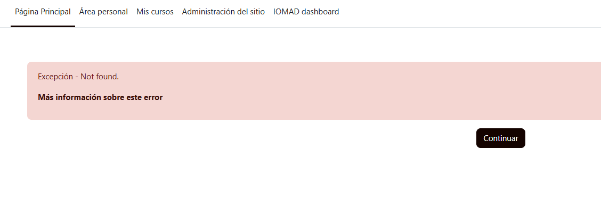

# 4. Problemas conocidos

## "Excepción - Not found" en la Página Principal y el Área personal



**Síntoma:** tras instalar, la *Página Principal* y el *Área personal* muestran "Not found". El panel de administración y el *IOMAD dashboard* funcionan, porque usan ficheros que existen realmente.

**Causa probable:** el mensaje lo genera el **router de Moodle**, es decir, la línea `FallbackResource /r.php` de Apache. En la 4.5 es opcional (pasa a obligatorio desde la 5.1) y con IOMAD puede fallar en direcciones sin fichero como `/` o `/my/`.

### Paso 1: desactivar el router

```bash
sudo sed -i 's/^\(\s*\)FallbackResource/\1#FallbackResource/' /etc/apache2/sites-available/iomad.conf
grep -n FallbackResource /etc/apache2/sites-available/iomad.conf
sudo systemctl reload apache2
sudo -u www-data php /var/www/iomad/admin/cli/purge_caches.php
```

El `grep` debe mostrar la línea con `#` delante. Después, en el navegador, `Ctrl+F5` en `http://localhost:8080` y probar *Página Principal* y *Área personal*. Con la 4.5 es válido dejarlo así; para producción conviene configurar el router correctamente: <https://docs.moodle.org/500/en/Configuring_the_Router>.

### Paso 2: si sigue fallando, averiguar qué URL falla

Probar directamente:

- `http://localhost:8080/index.php`
- `http://localhost:8080/my/index.php`

Si funcionan y las otras no, el problema es cómo Apache gestiona las direcciones sin fichero. Para ver el detalle:

```bash
sudo tail -n 40 /var/log/apache2/iomad_error.log
sudo tail -n 20 /var/log/apache2/iomad_access.log
```

El segundo muestra la dirección pedida y el código de respuesta (200, 404, 500).

### Paso 3: activar el modo depuración de Moodle

*Administración del sitio > Desarrollo > Depuración*: poner `DEVELOPER` y activar mostrar mensajes. Al repetir el error saldrá la traza con el fichero causante. Solo en el laboratorio, y volver a dejarlo en `Normal` después.

### Otras causas posibles

- **Dirección distinta:** usar siempre `http://localhost:8080`, no `127.0.0.1:8080`, porque el sitio está configurado con `localhost`. Comprobar con `grep wwwroot /var/www/iomad/config.php`.
- **Permisos cerrados:** si el error empezó justo después de los `chown` de cierre, probar temporalmente `sudo chown -R www-data:www-data /var/www/iomad`. Es solo una comprobación, no una solución definitiva.
- **Caché:** `purge_caches.php` (paso 1) ya lo cubre.

### Si nada funciona

Volver a la instantánea de la máquina (`iomad-instalado` o `servidor-base`) y repetir la configuración de Apache **sin** la línea del router.
